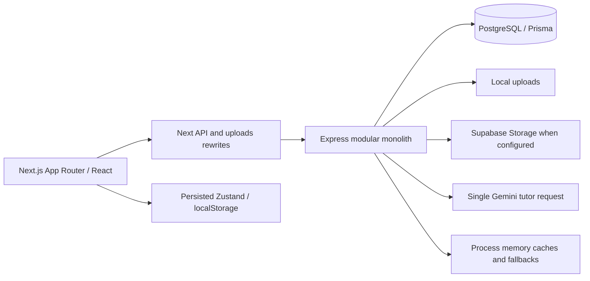
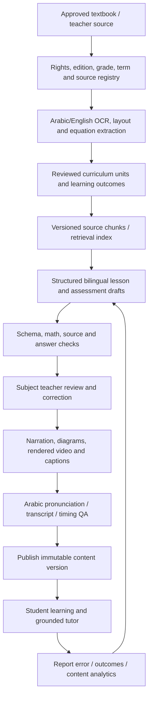
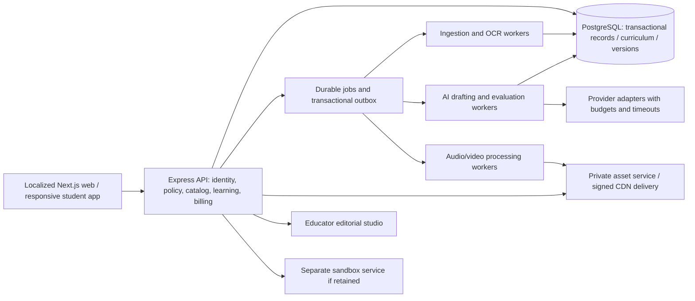

> **Historical audit — revised scope notice (21 October 2026).** Observations below retain their original evidence. AI generation/tutoring recommendations and AI-dependent release requirements are withdrawn. Use the [current documentation](../docs/README.md) and [explicit finding/acceptance disposition](../docs/AUDIT_TRACEABILITY.md). The original body is preserved below; it is not the current product specification.

# EduPlatform: code, architecture, and product readiness review

Review date: **21 October 2026**. Baseline commit: **2fbdc8e**. Workspace: **D:\digital platform**.

**Release decision: do not launch a public paid product in the current state.** The project is a useful LMS prototype with substantial authoring and administration work. It needs security and learning-flow repairs, and its central intended capability—turning approved Egyptian curriculum sources into reliable bilingual lessons, videos, quizzes, and assignments—has not been implemented.

Keep the modular monolith and most of the existing UI. A wholesale rewrite or immediate microservice split would add risk. Concentrate first on a consistent content-access policy, versioned curriculum/content, reliable assessment state, private media delivery, and a background AI production pipeline.

## 1. Scope, evidence, and limits

The repository inventory contains **171 production TypeScript/TSX files, approximately 30,796 lines**, **67 backend test files**, **7 browser test files**, and **171 route declarations in route files**. Inline application routes are additional. There are **no frontend component/unit test files** in the source tree. The inventory is generated in [inventory.json](<D:/digital platform/audit/inventory.json>).

This review combines repository-wide structural/static searches, detailed examination of every backend domain and the principal frontend flows, independent local probes, dependency advisory checks, and the executable checks below. It does not certify the absence of other bugs. Database concurrency, actual gateway settlement, AI provider output, and production infrastructure need further validation in a working isolated environment.

Evidence labels used below:

- **R**: reproduced in a local probe with process-local database doubles or a harmless local fixture. This verifies the application branch/response, not a real database transaction or a deployed exploit.
- **S**: confirmed by the current source or compiler.
- **C**: conditional architectural/concurrency risk requiring the specified environment or concurrent execution to demonstrate.
- **G**: product capability absent or incomplete; not a claim that a nonexistent feature malfunctioned.

### Executed validation

| Check | Result | Interpretation |
|---|---|---|
| Backend typecheck after refreshing generated Prisma types | **Fails:** `config.routes.ts:23`, TS2554, `z.record(z.any())` supplies one argument to the installed Zod 4 type signature | A real source build blocker, distinct from initial stale Prisma errors. Use an explicit key and value schema. |
| Database-independent backend tests | **108 passed across 16 files** | Positive evidence for the selected unit paths only. [Raw results](<D:/digital platform/audit/unit-tests.json>) |
| Same selected tests with V8 coverage | Tests pass; coverage thresholds fail | Imported-file coverage: **46.70% statements, 34.48% branches, 66.37% functions, 47.41% lines**. This is a partial unit run, **not whole-project coverage**. [Log](<D:/digital platform/audit/unit-coverage.log>), [HTML](<D:/digital platform/audit/unit-coverage/index.html>) |
| Frontend lint, existing installation | Passed | The ESLint configuration disables `no-explicit-any` and makes several checks warnings. |
| Frontend after lockfile restoration | **Production build and standalone typecheck pass** | Both initially missing CodeMirror dependencies were already declared. `npm ci --ignore-scripts` restored the installation; the missing-package failures were environmental. See the final frontend validation addendum below. |
| Full database-backed tests | **Not validated** | Both configured local PostgreSQL ports, 5433 and 5434, were closed. The full run was stopped rather than interpreting unavailable infrastructure as product failures. |
| Playwright journeys | **Not validated end to end** | Require a running API and seeded isolated database; no production/browser success is claimed. |
| Independent backend defect probes | **14 probe records; all completed** | Include anonymous file access, spoofed upload types, answer leaks, teacher identity overrides, inconsistent access, and stale authorization. One record covers identifiers F02 and F03 together. [Results](<D:/digital platform/audit/reproduction-results.json>) |
| Production frontend behavior probes | **6 observations reproduced in Chromium using intercepted API fixtures** | Persisted Arabic root attributes, wrong careers route, hidden section lessons, missing lesson text/blocks, demo whiteboard ID, and blocked free preview. These are frontend behavior checks, not real API/database E2E verification. [Results](<D:/digital platform/audit/browser-probe-results.json>) |
| Locked dependency advisory scan | Server: **20 matching advisory entries / 19 distinct URLs / 10 packages**. Client: **46 entries / 40 distinct URLs / 11 packages** | Entries can repeat an advisory across package names or version ranges. They are not counts of independently exploitable application bugs. Runtime/dev paths and locked versions are in the summary files. |

The local Prisma generation command encountered a Windows DLL replacement lock even with approved execution. Generated schema declarations were refreshed sufficiently to reduce the original stale-type errors to the single Zod source error above. Treat a fresh CI install/generate/build as a required release gate. The local runtime is Node 24.19.0; CI specifies Node 22. This review did not alter application source, run schema migrations, seed a database, or rotate credentials.

### Existing work that should be preserved

The current source has stronger protections than several older audit documents describe: public administrator registration is blocked, refresh tokens are hashed in a server-side registry and delivered in an httpOnly cookie, MFA challenge tokens are excluded from ordinary authentication, many ownership checks exist, drafts are generally hidden from public course reads, quiz attempts are graded on the server, and order fulfillment uses a conditional paid transition with an atomic entitlement grant. Assignment authoring/grading UI, course editing/reordering, and completion persistence now exist.

The old findings about a missing MFA login controller, a universally hardcoded player access flag, or entirely missing assignment authoring should **not** be carried forward as current findings. Only example environment files are currently tracked. This does not establish that historic credentials were never exposed; the separate hardcoded seed credential finding remains current.

## 2. Architecture assessment

| Area | Assessment |
|---|---|
| Application structure | Sensible starting modular monolith. Controllers/services are recognizable, but several controllers access Prisma directly and some services import other domains dynamically. Domain boundaries are conventions rather than enforced contracts. |
| Curriculum | Three competing representations exist: sections, modules, and configurable lesson blocks. Both lesson parent references are nullable, without a database invariant requiring exactly one parent. The player does not consume the complete authoring representation. |
| Assessments | `Quiz/Question/QuizAttempt` and `Assessment/QuestionPool/QuestionItem/AssessmentAttempt` implement separate grading, timing, ownership, and translation contracts. Their safety and behavior have already diverged. |
| Commerce | `Subscription` and `Entitlement` are parallel access systems. A shared resolver exists, but UI checks, teacher analytics, announcements, and some reads bypass it. |
| Data integrity | Important logical relationships are bare strings: assignment lesson/creator IDs, course academic-year IDs, product/entitlement resource IDs, video owner IDs, and discussion author/course/lesson IDs. Several cannot be protected by foreign keys in the current shape. |
| Reliability | Upload, database creation, pricing, audit, email, and notifications are often separate operations. Memory fallbacks turn durable-operation failures into success responses. Redis exists in Compose but is not the backing store for the implemented cache or rate limiter. |
| Frontend | Large components mix network orchestration, authorization heuristics, forms, and presentation. Several 20–60 KB components and pervasive `any` types make contract drift easier. A shared request helper and modal primitive are good foundations. |
| Operations | No versioned Prisma migration directory, application Dockerfile, application deployment definition, shutdown/drain logic, durable job queue, or backup/restore automation was found. Compose provisions supporting data services only. |

## 3. Security and access defects

### SEC-01 — P0: known privileged seed credential and password reset on every seed [S]

[seed.ts:11](<D:/digital platform/server/prisma/seed.ts:11>) contains a literal administrator password and identifiable administrator account. Its `upsert.update` resets that account's password and administrator role whenever seeding runs. Demo accounts also have fixed known passwords. No production guard prevents this seed from being run against a live database.

Remove privileged literals, separate safe reference-data seeding from demo users, require secure one-time administrator provisioning, and rotate the seeded credentials wherever used. Do not copy the credential into tickets or public reports. Check history and deployment usage before deciding whether history cleanup is necessary.

### SEC-02 — P0: private and paid files bypass authorization through static hosting [R: F01]

[app.ts:72](<D:/digital platform/server/src/app.ts:72>) serves the entire uploads root without authentication. A local video fixture returned **HTTP 200 anonymously** despite the existence of a separate signed streaming endpoint. Materials and student submission files share the same public namespace. Cloud lesson materials also use public URLs in [storage.ts](<D:/digital platform/server/src/utils/storage.ts>).

Move protected assets to private storage, remove the catch-all public upload mount, and issue narrowly scoped download/playback grants after checking the requesting user's access. Student submissions need student/assigned-grader authorization. Filename obscurity is insufficient.

### SEC-03 — P0: allowed upload MIME can host active HTML/JavaScript on the app origin [R: F15]

[assignment.routes.ts](<D:/digital platform/server/src/modules/assignments/assignment.routes.ts>) trusts client-supplied MIME, while [storage.ts](<D:/digital platform/server/src/utils/storage.ts>) retains the filename extension and static serving chooses the response type from that extension. Harmless `.html` and `.js` fixtures submitted as `application/pdf` were accepted with **201** and anonymously served as **text/html** and **text/javascript**.

This establishes an active-content hosting path and a stored-XSS risk when a user opens attacker-supplied material. Browser execution/exfiltration was not attempted. Validate actual file signatures and allowed extensions, generate server-owned names, scan/quarantine content, force attachment disposition where appropriate, and serve user content from a separate origin without application credentials. Existing MIME filters do not provide these guarantees.

### SEC-04 — P0: public course payload includes paid lesson content and storage paths [R: F02-F03]

[course.service.ts:152](<D:/digital platform/server/src/modules/courses/course.service.ts:152>) includes full lesson text, videos, materials, quizzes, and block configurations before returning a public published course. The list endpoint also loads nested lesson resources. The sanitizer only removes selected answer fields; it does not check enrollment or redact protected resources. A client paywall cannot protect these API responses.

Split catalog metadata from authenticated learning delivery. Return only lesson titles/preview metadata from catalog endpoints. Enforce access before serializing each protected lesson/resource, including non-video text and blocks.

### SEC-05 — P0: short-answer keys survive course sanitization [R: F02-F03]

[course.service.ts:13](<D:/digital platform/server/src/modules/courses/course.service.ts:13>) spreads each question, strips option `isCorrect`, and clears `explanation`, but retains `correctAnswer`. An anonymous course response returned a short-answer key. Build student DTOs from explicit allowed fields and verify recursively that every answer-key representation is absent.

### SEC-06 — P1: PRIVATE/UNLISTED visibility is not enforced [R: F02-F03]

Public course reads check publication status, not the `visibility` field. A published `PRIVATE` fixture returned **200 anonymously**. Neither private cohort access nor unlisted discovery semantics are implemented. Include visibility in catalog queries and per-course authorization; test all role/visibility/publication combinations.

### SEC-07 — P1: any teacher receives any quiz's answer key [R: F04]

[quiz.controller.ts:33](<D:/digital platform/server/src/modules/quizzes/quiz.controller.ts:33>) treats the global teacher role as permission to retrieve answers. `GET /quizzes/:id` does not check ownership, approval status, course access, or course publication. Standalone quizzes also have no creator relation and are explicitly editable by any approved teacher in [quiz.service.ts:152](<D:/digital platform/server/src/modules/quizzes/quiz.service.ts:152>).

Add a creator/owner and policy for quiz reads/edits. Teacher status alone must not grant access to another teacher's assessment answers. Make any shared question-bank policy explicit and separate from private course assessments.

### SEC-08 — P1: submitted and expired exams return internal answer snapshots [R: F05]

[assessment.service.ts:315](<D:/digital platform/server/src/modules/assessment/assessment.service.ts:315>) and [assessment.service.ts:369](<D:/digital platform/server/src/modules/assessment/assessment.service.ts:369>) return raw attempt rows, including `questionsSnapshotJson` containing `correctAnswerJson`. Starting/reading an attempt sanitizes it, but submitting/expiring it does not. Students can collect answer banks for further attempts or other students. Return a dedicated result DTO and define when answer review is permitted.

### SEC-09 — P1: request body can impersonate another teacher [R: F07/F08]

[teacher.controller.ts:30](<D:/digital platform/server/src/modules/teacher/teacher.controller.ts:30>) and [live.controller.ts:9](<D:/digital platform/server/src/modules/live/live.controller.ts:9>) use `{ teacherId, ...req.body }`. Submitted `teacherId` overrides the authenticated identity. The announcement service's ownership check then sees the victim teacher ID; live sessions can be attributed to another account. Construct validated DTOs first and assign authenticated identity last, or pass it separately from user-controlled input.

### SEC-10 — P1: role, approval, and password changes do not revoke authorization consistently [R: F12; S]

[auth.middleware.ts](<D:/digital platform/server/src/modules/auth/auth.middleware.ts>) checks current activation but trusts JWT role and teacher approval. A token carrying ADMIN was still authorized as ADMIN when the database double reported STUDENT. [admin.service.ts:276](<D:/digital platform/server/src/modules/admin/admin.service.ts:276>) updates roles, activation, and password without the cache invalidation/session revocation performed by its separate activation method. Rejected approval does not invalidate already issued approved-teacher claims.

Use a session/token version or a current user authorization record. Route every security-sensitive mutation through one revocation path. Verify the next request after demotion, rejection, deactivation, and password reset. Across multiple API processes, process-local invalidation alone is insufficient.

### SEC-11 — P1: rejected teachers can log in [R: F11]

[auth.service.ts:118](<D:/digital platform/server/src/modules/auth/auth.service.ts:118>) blocks only PENDING teachers, not REJECTED teachers. A rejected fixture received a session. The approval middleware blocks some operations, but shared authenticated endpoints remain accessible. Define and enforce a consistent rejected-account policy in login, refresh, MFA completion, and authorization.

### SEC-12 — P1: course discussions and assignment reads bypass learning access [S]

[discussion.controller.ts](<D:/digital platform/server/src/modules/discussions/discussion.controller.ts>) allows any authenticated account to list a course's complete threads/replies and post to it, without validating membership or the relationship between submitted course and lesson IDs. Assignment detail and lesson-assignment listing in [assignment.routes.ts](<D:/digital platform/server/src/modules/assignments/assignment.routes.ts>) similarly lack the learning-access guard applied to submission. Question pools are globally readable and writable by approved teachers with no ownership field. Apply a shared content/ownership policy to reads and writes, not just attempts and submissions.

### SEC-13 — P1: refresh-token consumption is not atomic [C]

[auth.service.ts:232](<D:/digital platform/server/src/modules/auth/auth.service.ts:232>) reads `revokedAt` before the transaction, then revokes by ID without a `revokedAt: null` predicate. Two simultaneous refreshes can both observe a valid token and issue successors. Browser tabs can also race and trigger all-session revocation on later reuse. Use atomic conditional consumption, a session/family identifier, and an explicit concurrent-refresh policy. This requires real-database parallel tests; the current unit run does not prove the race absent.

### SEC-14 — P2: MFA enrollment, storage, recovery, and replay handling are incomplete [S/C/G]

MFA secrets are stored directly in the user row. Re-enrollment sets `mfaEnabled: false` before the new factor is confirmed. There is no implemented backup-code or account recovery flow despite README claims. [totp.ts](<D:/digital platform/server/src/utils/totp.ts>) performs replay protection as a separate read then update, allowing a potential concurrent-use race. Stage pending enrollment separately, encrypt secrets with managed keys, implement recovery, and consume time steps atomically.

### SEC-15 — P1 if enabled: code execution runs on the API host [C]

[playground.controller.ts](<D:/digital platform/server/src/modules/courses/playground.controller.ts>) is correctly disabled by default, but enabling one environment flag starts Python under the API's OS identity. Isolated Python mode, a scrubbed environment, output limits, and a timeout do not prevent filesystem access, network access, memory exhaustion, or descendant processes. CI enables the flag on a runner with application secrets. Move execution to a separately sandboxed worker with no API secrets, resource quotas, network denial, and process-tree termination. Keep the feature disabled until this exists.

## 4. Commerce, subscriptions, and financial correctness

| ID / priority / evidence | Defect and impact | Required correction |
|---|---|---|
| COM-01 / P1 / R:F06 | [checkCourseAccess](<D:/digital platform/server/src/modules/commerce/commerce.service.ts:419>) only reads `Entitlement`, while the shared resolver also reads active `Subscription`. The player accepts a boolean false from this endpoint and never reaches its fallback. A paying subject subscriber can therefore see a paywall while the video/material services authorize access. | One access decision service and one response contract for UI, media, attempts, teacher rosters, and announcements. |
| COM-02 / P1 / S | [subscription.service.ts:46](<D:/digital platform/server/src/modules/subscriptions/subscription.service.ts:46>) rejects another subscription when an existing row has ACTIVE status, regardless of its expired `endDate`. No expiry worker was found. | Query effective date ranges; support renewal/extension explicitly and reconcile stored state. |
| COM-03 / P2 / S | Calendar arithmetic uses `setMonth`, which overflows at month ends; e.g. a January 31 monthly subscription can end in March. Approval and rejection are separate read/update operations and can race. | Define billing boundary rules, use clamped calendar calculations, and conditional state transitions. |
| COM-04 / P1 / S/G | Payment callbacks are custom simulations of gateway contracts. Paymob expects a nested transaction payload and its documented HMAC field sequence; this code signs sorted arbitrary key/value pairs and accepts header signatures only. Fawry uses custom field names, status handling, and a custom signature scheme, explicitly acknowledged in [webhook-security.ts](<D:/digital platform/server/src/utils/webhook-security.ts>). No real gateway checkout creation was found. | Implement provider adapters against the selected official API versions and sandbox fixtures. Check merchant, currency, exact amount, provider transaction ID, terminal payment state, and order mapping. Keep manual payment as the advertised path until validated. |
| COM-05 / P1 / R:F09 | [createOrder](<D:/digital platform/server/src/modules/commerce/commerce.service.ts:56>) returns any order with the caller's idempotency key, without checking owner or original request fields. Knowledge/reuse of a key returns another student's order/reference. Concurrent first requests also have a find-then-create conflict. | Scope keys to the user and operation, verify payload identity, and atomically handle unique-key conflicts. |
| COM-06 / P1 / S/G | [fulfillOrder](<D:/digital platform/server/src/modules/commerce/commerce.service.ts:301>) permits any status except PAID to become PAID, including REFUNDED/CANCELLED. No refund/revocation workflow is implemented; gateway callbacks are not constrained to the order's payment method and transaction references are not unique. | Explicit state machine, immutable payment-event ledger, deduplicated provider events, refund/reversal handling, and entitlement revocation. |
| COM-07 / P1 / S | Products can lack or reference nonexistent resources. A paid order with no resource is committed without access. `ProductType.VOUCHER` is cast to an entitlement type that has no VOUCHER enum member. Every purchase receives a hardcoded 180-day entitlement. | Validate product/resource compatibility and existence before selling; snapshot duration/access rules on the order; make failed fulfillment an actionable durable state. |
| COM-08 / P1 / C | Voucher max-use increments are protected, but same-student deduplication occurs before acquiring the voucher row lock and there is no redemption uniqueness record. Concurrent requests from one student can consume multiple uses and create duplicate grants when `maxUses > 1`. | Add unique voucher/student redemption records and test same-user concurrency, not only ten different students. |
| COM-09 / P1 / S | Entitlement resolvers check expiry but not `startsAt`; future-dated grants can work immediately. Several teacher/analytics queries also ignore expiry. Archived/unpublished course state is not consistently included in learning authorization. | Centralize effective-date and course-state policy; specify what enrolled users retain when content is archived. |
| COM-10 / P1 / S | [teacher.service.ts](<D:/digital platform/server/src/modules/teacher/teacher.service.ts>) counts subject entitlements for rosters/announcements but omits normal subscriptions, direct course purchases, and grade bundles. The course dashboard counts direct course entitlements instead. Revenue is fabricated as `students.length * 1500`. | Resolve the same enrolled audience everywhere, deduplicate recipients, respect dates, and derive financial metrics from paid/refunded ledger entries. Remove estimated revenue from production presentation. |
| COM-11 / P1 / S | Course/product creation and pricing updates are separate operations. A failure can leave a course without a valid product or display state inconsistent with checkout. Course deletion tries to delete products referenced by historical orders. | Use transactions for related database writes, retain immutable purchase history, and archive sellable resources instead of deleting ledger dependencies. |
| COM-12 / P2 / S | [CheckoutModal](<D:/digital platform/client/src/components/commerce/CheckoutModal.tsx:84>) creates a new idempotency key on every retry, does not persist the selected transfer method, does not resume pending checkout after reopening, and leaves FAILED orders shown as pending. No destination payment details/configuration are provided in that flow. | Persist checkout state/key, provide verified payment instructions and receipt review, and surface rejected/expired/retry states accurately. |

The gateway-contract assessment is based on [Paymob's official callback example](https://developers.paymob.com/paymob-docs/developers/transaction-callbacks), its [official HMAC reference](https://github.com/PaymobAccept/Paymob-AI-Integration-Skill/blob/main/skills/paymob-integration/references/hmac-verification.md), and [Fawry's notification V2 contract](https://developer.fawrystaging.com/docs/plugins/payment-notifications/server-notification-v2). These must be matched to the actual merchant integration selected; passing the existing custom-signature tests does not establish compatibility.

## 5. Learning, authoring, and user-interface defects

| ID / priority / evidence | Current behavior | Required correction |
|---|---|---|
| LRN-01 / P1 / S | [quiz.service.ts:287](<D:/digital platform/server/src/modules/quizzes/quiz.service.ts:287>) updates an expired attempt and then throws inside its transaction. The same occurs during late submission at line 398. Throwing rolls the expiry update back, leaving the attempt in progress and capable of trapping the student in repeat errors. | Commit expiry as a normal transaction result, then return an error/result outside the transaction. Test database state after the HTTP error and starting the next allowed attempt. |
| LRN-02 / P1 / S | Quiz `dueDate` is saved but never checked in start/submit. Quiz definitions are editable by deleting/recreating questions while attempts reference the live definition. Existing/in-flight work can be graded against changed IDs/answers. | Enforce availability windows and freeze a versioned assessment snapshot per attempt. Retain definitions for audit and regrading. |
| LRN-03 / P1 / G/S | Quiz essays enter AWAITING_REVIEW but no quiz review/grading endpoint or teacher queue completes them. The separate assessment engine grades every question, including essays, using lowercased string equality. | Either disable unsupported types at launch or implement rubrics, a human review queue, partial credit, and explicit pending-grade results. |
| LRN-04 / P1 / C | [assignment.service.ts](<D:/digital platform/server/src/modules/assignments/assignment.service.ts>) checks submission count then creates a submission without transactional serialization. Assessment submission similarly checks status then updates without atomically claiming the attempt. | Concurrent submission tests and atomic state/attempt-limit enforcement; idempotent submission identifiers. |
| LRN-05 / P1 / S | Published course lessons, resources, quizzes, and blocks can be edited without creating a new reviewable revision. [reviewCourseStatus](<D:/digital platform/server/src/modules/courses/course.service.ts:704>) can publish from arbitrary prior states and skips the completeness gate used by the separate publish method. | Version drafts separately from published revisions, enforce allowed transitions, and publish only the exact reviewed version. This is particularly important for AI-generated factual content. |
| LRN-06 / P1 / S | [VideoPlayerSection](<D:/digital platform/client/src/components/VideoPlayerSection.tsx:118>) copies resource/block data but has no renderer for lesson `content`, TEXT/LINK/DOCUMENT/LIVE_SESSION blocks, or their required ordering. Teachers can author content that students cannot consume. | A typed block renderer, required-block completion rules, and authoring-to-player acceptance tests for every supported type. |
| LRN-07 / P1 / S | The player uses modules **or else** sections, hiding all section lessons if any module exists. Progress counts both trees. The database allows no parent or two parents, including parents in different courses. | One canonical hierarchy; migrate existing data; enforce exactly one parent and consistent course ownership during transition. |
| LRN-08 / P1 / S | The whiteboard is rendered without its block ID, defaults to `demo-board-1`, and receives 404 from the corrected backend. It loads once and saves manually, with no realtime synchronization. Students are shown save controls even though backend writes are owner/admin-only. | Pass the real block ID; show read/write capabilities; choose a single-user board or implement a real collaboration service with conflict resolution. Add touch/pointer support and canvas coordinate scaling. |
| LRN-09 / P1 / S | A course-level paywall replaces the entire player for users without access, so section-level free previews are not usable. Module lessons have no preview field in the schema. | Make access and preview decisions per lesson/resource. Anonymous preview URLs need an explicit policy rather than accidental public storage. |
| LRN-10 / P1 / S | [InteractiveQuizRunner:147](<D:/digital platform/client/src/components/player/InteractiveQuizRunner.tsx:147>) ignores the returned start time and sets a fresh local deadline. A resumed attempt appears to have a full duration although the server's deadline is earlier. State such as answers, question index, and result is not fully reset when the `quiz` prop changes. | Return and use server `expiresAt`; key/reset the runner by attempt and quiz version; autosave answers and recover after reload. |
| LRN-11 / P1 / S | [AssessmentRunner:76](<D:/digital platform/client/src/components/player/AssessmentRunner.tsx:76>) invokes `tick()` before `const interval` is initialized. An already-expired response can execute `clearInterval(interval)` in the temporal dead zone. | Initialize the interval safely or separate initial expiry handling; test a response arriving after its deadline. |
| LRN-12 / P1 / S/G | The video player sends completion but never sends watch-time updates; there is no persisted resume position. Completion failures are swallowed after optimistic local success, without the claimed retry. Switching lessons/courses while async requests resolve can set stale player state. | Persist bounded/idempotent progress heartbeats and resume position, show pending/failed synchronization, and cancel or ignore stale requests. |
| LRN-13 / P1 / S | [AnnouncementManager:27](<D:/digital platform/client/src/components/teacher/AnnouncementManager.tsx:27>) submits no `courseId`, which the backend requires. Ordinary UI broadcasts cannot resolve the course and an undefined unique ID can fail Prisma validation before any notification is sent. | Add an owned-course selector and use a validated API contract; then verify real recipient counts. |
| LRN-14 / P1 / S/G | [live.service.ts:25](<D:/digital platform/server/src/modules/live/live.service.ts:25>) invents Zoom meeting IDs/URLs rather than creating meetings. The UI's entered URL is ignored. StudentDashboard expects `summary.courses[].subjectId`, which the summary does not return, so it never fetches live sessions. | Integrate a real meeting provider or accept validated existing meeting links; complete list/edit/cancel/attendance flows and return the subject IDs the UI consumes. |
| LRN-15 / P2 / S/G | [CourseCatalog:100](<D:/digital platform/client/src/components/CourseCatalog.tsx:100>) calls `/career-tracks`, while the API exposes `/careers`. It requests 200 courses but the backend caps the response at 100; there is no paging/search/filter UI. Teacher catalog queries ignore some supplied filters, so teachers can see their drafts in the public browsing view. | Correct the route, add typed query contracts, server paging, grade/subject/term filters, Arabic-aware search, and consistent public/studio catalogs. |
| LRN-16 / P1 / S/G | Arabic support is partial: core player, quizzes, board, AI errors, catalog title, and many management controls contain English-only text. Persisted Arabic/RTL state does not rerun `setLang` on hydration; the root remains `lang="en"` unless toggled. There is no `/ar`/`/en` URL or server-rendered locale metadata. Quiz question text, lesson body, and many descriptions have one language field. | Centralize translation catalogs and locale formatting, hydrate document attributes, use logical CSS properties, model linked content translations, and test complete Arabic and English journeys. |

## 6. Infrastructure, implementation quality, and product claims

| ID / priority / evidence | Finding | Release action |
|---|---|---|
| ENG-01 / P0 / compiler | Zod 4 record schema blocks backend typecheck/build at [config.routes.ts:23](<D:/digital platform/server/src/modules/config/config.routes.ts:23>). | Correct the type signature, validate nested home-content structure, run clean-install typecheck/build. |
| ENG-02 / P1 / R:F10 | `exchangeRateUsdToEgp` is omitted from the config body schema. Zod strips it, so submitting 60 returns success with the original 48 and empty update data. | Add positive finite rate validation; invalidate rate caches and define how stored/displayed price conversions update. |
| ENG-03 / P1 / S | Teacher registration, course-approval, board, and playground flags are stored/displayed but not consistently enforced server-side. A hidden registration control does not disable its API. | Enforce operational policy at service boundaries; distinguish a display setting from a security/cost control. |
| ENG-04 / P1 / S | Route inventory identifies **43 POST/PATCH/PUT declarations without `validateBody`**. Some are legitimate bodyless commands or multipart routes, so this is not 43 proven validation bugs. Important unvalidated bodies include live sessions, announcements, product/voucher creation, resource/block attachment, and developer endpoints. | Validate body, query, params, nested JSON, URLs, array/string bounds, and relationship IDs. Convert unexpected Prisma/type errors to consistent client errors. |
| ENG-05 / P1 / S | No migration history is present. [CI](<D:/digital platform/.github/workflows/ci.yml>) uses `prisma db push`, testing the latest empty-schema shape rather than upgrades from an existing production database. The schema requires `DIRECT_URL`, omitted from the server environment example. | Check in migrations, use `migrate deploy`, test forward upgrades with existing data, and document the connection/pooling setup accurately. |
| ENG-06 / P1 / R:F14/S | `/health` returns HTTP 200 when the database is unavailable. [server.ts](<D:/digital platform/server/src/server.ts>) lacks graceful draining/shutdown. Storage errors silently fall back to local disk; a multi-instance deployment can lose or split uploads. | Separate liveness/readiness, return 503 for failed required dependencies, drain connections, and fail explicitly or enqueue retries on durable storage failures. |
| ENG-07 / P1 / S | Audit fallback is process memory. Course review logs actor ID `'ADMIN'`, which is not a real user FK, so reviews can fall into this fallback and disappear on restart. Other successful DB reads do not merge those fallback logs. Developer token/webhook creation also reports memory-only success after DB errors. | Record actual actors, durable audit/outbox events, observable failures, and no fake success for durable writes. Bound queues and retention. |
| ENG-08 / P2 / S | Public config uses find-first/create without a singleton constraint; public subject reads can seed defaults; careers reads rewrite default tracks and link subjects on every request. Dynamic subject find-or-create has no supporting case-insensitive unique constraint. | Explicit reference-data migrations/jobs, a fixed singleton config key, unique taxonomy keys, and side-effect-free public reads. |
| ENG-09 / P1 / S/C | Video uploads buffer up to 500 MB per request in API memory; several parallel uploads can exhaust it. All allowed video types are marked READY immediately and streamed as `video/mp4`; AVI/MKV/etc. are not automatically browser-compatible. No transcoding, adaptive HLS, AES key pipeline, captions, or thumbnail job exists. Range parsing is not validated and streams lack error listeners. | Direct resumable uploads, validated media probing, queued transcoding, appropriate MIME/range responses including 416, private CDN delivery, captions and low-bandwidth renditions. |
| ENG-10 / P2 / S | Course catalog loads full nested lessons/questions/resources for up to 100 courses, and multiple list endpoints are unbounded. Memory cache/rate limits are per process despite Redis infrastructure. API request deadlines, per-user AI/media quotas, and load budgets are missing. Morgan request logs include query-string stream tokens. | Small catalog DTOs, pagination/query budgets, shared rate/cost controls, request deadlines, query-log redaction, and measured load tests. |
| ENG-11 / P1 / G | No complete email verification, password reset/change, student account recovery, parental linking, or guardian role exists. The schema supports only STUDENT/TEACHER/ADMIN. Some verification email helper code is unreachable. | Add recovery and verification before onboarding real users. Decide explicitly whether guardians are in the first release; remove unsupported claims until implemented. Minimize collected school identifiers and design the guardian/data-processing policy with qualified local review. |
| ENG-12 / P2 / G | Developer tokens are created/listed but cannot authenticate API requests, enforce scopes, expire through a management flow, or be revoked via exposed routes. Webhooks are registered/listed but no event delivery/retry worker uses them. `EventDispatcher` has no application publishers/subscribers. | Defer these surfaces or complete scoped token authentication and durable signed webhook delivery with retries/replay protection. Current URL validation should not be mistaken for production SSRF-safe delivery. |
| ENG-13 / P1 / S | CI runs backend tests without coverage and has no Playwright job, dependency advisory gate, or migration-upgrade test. Browser tests skip video access, conditionally skip admin paths, and sometimes accept an empty catalog. The RTL assertion accepts either direction after toggling. | Make required journey fixtures deterministic; remove permissive assertions/skips for release gates; publish coverage with all intended source files included. See the separate test matrix. |
| ENG-14 / P1 / S | [fetchApi](<D:/digital platform/client/src/lib/api.ts:128>) excludes every `/auth/*` request from auto-refresh, including protected profile reads/updates, so a valid refresh session does not recover an expired access token on the profile page. Its refresh helper also treats every non-2xx response—including 429/500/503—as a dead session. User-specific persisted career preferences are not reset with the identity. | Exclude only login/refresh/challenge endpoints, classify terminal credential failures separately from retryable failures, and reset/scope identity-owned local state. Add deterministic request/state tests. |
| ENG-15 / P2 / S | README claims include encrypted HLS, a fully isolated playground, parent accounts, usable developer tokens/webhook delivery, and other capabilities absent from the implemented flows. The root MIT badge has no corresponding LICENSE file, while the server package declares ISC. | Publish a versioned capability/status document and an accurate runbook, clarify the intended software license, and remove release claims until their acceptance cases pass. |

### Dependency exposure at the lockfile versions

The npm advisory scan checked **332 server package names** and **478 client package names**, then filtered advisory ranges against the actual locked versions using semver. Server results include 1 critical, 8 high, 10 moderate, and 1 low entry; client results include 2 critical, 22 high, 19 moderate, and 3 low entries. These include development tools and conditional attack surfaces.

- **Next.js 14.2.35:** outside the supported major versions according to the [official support policy](https://nextjs.org/support-policy). Its locked version matches, among others, the [Windows-hosted RCE advisory](https://github.com/vercel/next.js/security/advisories/GHSA-p293-qw3h-jr36). Applicability depends on deployment conditions; a Windows-hosted deployment warrants immediate attention. Do not claim this application was exploited.
- **Multer 2.2.0:** matches multiple denial-of-service advisories. The [maintainer advisory](https://github.com/expressjs/multer/security/advisories/GHSA-wc9g-mqfw-jrwm) describes process termination from multipart parsing; this application's upload routes require authentication, which changes exposure but does not remove the vulnerable parser.
- Other matched runtime dependencies include Morgan, proxy-addr, qs, Tiptap/ProseMirror, markdown-it, and build/CSS transitive packages. A proxy-addr trust-subnet issue, for example, needs configuration-specific triage; this code currently uses a hop-count proxy policy rather than a configured subnet list.

Upgrade to a supported, patched framework line and compatible React/tooling versions, refresh upload/editor/parser dependencies, and rerun build, security, browser, and gateway tests. Do not apply `audit fix --force` without reviewing breaking changes. Full locked paths, ranges, and advisory URLs: [server summary](<D:/digital platform/audit/server-advisories-summary.json>), [client summary](<D:/digital platform/audit/client-advisories-summary.json>).

## 7. The missing AI educational product

### What exists

[ai.controller.ts](<D:/digital platform/server/src/modules/ai/ai.controller.ts>) accepts a prompt and caller-supplied `courseContext` and sends one concatenated string to Gemini. It does not retrieve authorized lesson content or curriculum sources. It has no real conversation history, curriculum citations, structured educational output, quality evaluation, per-student budget, timeout/cancellation policy, or persistent generation workflow. Without an API key it returns the same English Newton's-law explanation for an unrelated Arabic arithmetic question (**R: F13**).

The hardcoded `gemini-1.5-flash` model is retired: Google's [official shutdown table](https://firebase.google.com/docs/ai-logic/faq-and-troubleshooting) lists 24 September 2025 for this alias. The keyed provider branch was not called with live credentials during this review. Configure a supported model through a provider adapter and verify it in staging; do not replace provider failures with a fabricated educational success.

### Required curriculum-to-content workflow

| Capability | Minimum implementation for a credible first release |
|---|---|
| Source governance | SourceDocument with official/source URL, owner/permission record, checksum, edition, academic year, grade, term, subject, source language, and page references. Public availability must not be treated as a commercial reuse permission record. |
| Egyptian curriculum mapping | CurriculumVersion, term, branch/track, units, lessons and learning outcomes, with explicit grade/subject/year associations and editorial sign-off. Current arbitrary subject naming and two career keywords do not establish curriculum alignment. |
| Extraction | Store original files and extracted text/layout, tables, figures, equations and page coordinates. Evaluate Arabic OCR, bilingual science text, diacritics, numerals, and scanned diagrams; route low-confidence extraction to a reviewer. |
| Generation | Typed outputs for lesson objectives, prerequisites, worked examples, misconceptions, exercises, quiz options/keys/rationales, assignment rubrics, and glossary terms. Store model/prompt/schema versions, input source hashes, costs, and generation parameters. |
| Bilingual content | Two linked educational versions with a common concept/outcome ID; consistent approved Arabic/English terminology and equation notation. Translating UI labels is separate from translating learning content. |
| Verification | Page-level supporting citations, mathematical/numerical checks where applicable, valid distractors, unambiguous answer keys, duplicate/contradictory question detection, age/grade suitability, and educator acceptance. Generated text should remain a draft until approved. |
| Video/audio | Begin with AI-authored scripts, reviewed diagrams/slides, narration and deterministic rendering. Add scene-by-scene source links, transcripts, Arabic/English subtitles, thumbnails, playback speed, and adaptive low-bandwidth delivery. Avoid making expensive open-ended video generation a prerequisite for proving learning quality. |
| Tutor | Retrieve only the student's allowed published content/version. Answer in the chosen language, cite the relevant source, support follow-up context, prefer hints for assessed work, refuse unsupported factual claims, and give a clear unavailable state. Bound prompts, output, concurrency, daily cost, and retries. |
| Content lifecycle | DRAFT → VALIDATING → NEEDS_REVIEW → APPROVED → PUBLISHED → SUPERSEDED/RETRACTED. Keep who reviewed which source/version and why. A curriculum correction must identify and regenerate affected derivatives. |
| Feedback and safety | Student “report a content error”, educator escalation, correction notices, controlled rollback, moderation/reporting for community interactions, and a documented policy for student data sent to AI providers. |
| Evaluation | A subject-teacher-authored golden set of Arabic and English questions tied to exact curriculum editions. Evaluate factual accuracy, source support, answer validity, language quality, math rendering, inappropriate output, tutor leakage, and cost before changing a model or prompt. |

Recommended new entities: `CurriculumVersion`, `Term`, `LearningOutcome`, `SourceDocument`, `SourceChunk`, `ContentVersion`, `ContentTranslation`, `SourceCitation`, `GenerationJob`, `GenerationStep`, `GenerationArtifact`, `ReviewDecision`, `EvaluationRun`, `ContentIssue`, and `MediaAsset`. Add job idempotency, retry/backoff, cancellation, dead-letter handling and cost accounting. Keep provider credentials off student clients and code-execution workers.

## 8. Recommended target architecture

Use a single application/database initially, with asynchronous workers as separate processes/deployments. Define modules around identity, academic taxonomy, source/curriculum, authoring/review, learning/assessment, assets, commerce/access, and notifications. Modules should expose typed services rather than allowing arbitrary cross-domain Prisma access. Use an outbox for notifications, payment fulfillment events, content generation and webhooks that must survive restarts.

Specific refactoring order:

1. Create a shared authorization policy and student-safe DTO layer; separate catalog from learning payloads.
2. Introduce canonical curriculum parents and versioned content/attempt snapshots through migrations.
3. Consolidate commerce access decisions while retaining the existing atomic order fulfillment approach.
4. Unify assessment delivery/grading contracts; retain specialized question types as explicit capabilities.
5. Add a private asset model and worker-driven upload/processing lifecycle.
6. Add AI source ingestion, jobs, review, and evaluations after ordinary learning flows are correct.
7. Split large UI components into typed feature hooks/forms/renderers and generate/share API contracts. Do not split services merely to reduce file length.

## 9. Release plan and product enhancements

### Gate A — safe internal build

Fix SEC-01 through SEC-05, ENG-01, identity overrides, role revocation, and dependency upgrades. Restore clean installations and isolated database infrastructure. Make migrations, typecheck, server build, frontend build, and critical authorization regression tests pass. Keep paid onboarding and unsafe/unfinished features unavailable until this gate is met.

### Gate B — one reliable learning and purchase journey

Choose a deliberately narrow first audience—one defined grade/term/subject, or the existing Scientific Math positioning if that is the commercial decision. Repair subscription access, checkout/reconciliation, lesson/block rendering, quiz expiry, grading, completion/resume, Arabic UI, announcements, and real media playback. Prove student A cannot access student B's work and teacher A cannot manage teacher B's content. Document support and refund operations.

### Gate C — one reviewed AI curriculum unit

Ingest a permissioned real source, map its outcomes, generate linked Arabic/English lessons, verify all answers, obtain educator approval, render narrated/captioned media, and deliver the approved version through the same learning paths. Measure correction rate and learner outcomes. A fluent chat demo is not this acceptance criterion.

### Gate D — limited Egyptian student pilot

Test on the intended low-cost Android devices and slower connections, in both languages, with screen-reader/keyboard checks. Include account recovery, accessible captions/transcripts, content error reporting, clear pricing/access duration, payment failure handling, and human support. Rehearse backup/restore, content retraction, payment reconciliation, and an incident response. Resolve the student-data/guardian/third-party processing and content-rights decisions before real onboarding.

### After the pilot demonstrates learning value

- Outcome-based revision plans, prerequisite diagnostics, spaced repetition, mistake notebooks, and recommended next exercises.
- Exam blueprints and educator-validated practice/past-paper tagging; accessible math, diagrams and Arabic terminology search.
- Low-data downloads or offline study packs with explicit access/expiry rules; defer a separate native app until the responsive web journey is proven.
- Guardian progress summaries if included in the product strategy, with consent and scoped access rather than shared student credentials.
- Search by grade/term/topic, bookmarks, notes, transcript search, resume across devices, and student support ticketing.
- Editorial dashboards for source coverage, unreviewed generation, corrected content, evaluation regressions and per-approved-lesson cost.
- Revenue/refund reconciliation, cohort retention, lesson completion and mastery measures drawn from real events. Avoid equating watch time with understanding.
- Real collaboration, developer APIs, outbound webhooks, certificates, and broad multi-curriculum customization only after core learning and operational quality is stable.

Use completion criteria rather than a fixed delivery-date estimate: team size, curriculum rights, media quality, content volume, provider cost, and gateway onboarding are not established by this repository.

## 10. Handoff artifacts

- [Test gaps and release acceptance matrix](<D:/digital platform/audit/TEST_GAP_MATRIX.md>)
- [Reproduction script](<D:/digital platform/audit/reproduce-findings.cjs>) and [observed results](<D:/digital platform/audit/reproduction-results.json>)
- [Production frontend probe script](<D:/digital platform/audit/browser-probes.cjs>) and [browser observations](<D:/digital platform/audit/browser-probe-results.json>)
- [Route/module inventory](<D:/digital platform/audit/inventory.json>) and [generator](<D:/digital platform/audit/inventory.cjs>)
- [Passing unit-test result](<D:/digital platform/audit/unit-tests.json>) and [partial unit coverage](<D:/digital platform/audit/unit-coverage/index.html>)
- [Server typecheck log](<D:/digital platform/audit/server-typecheck.log>)
- [Server dependency advisories](<D:/digital platform/audit/server-advisories-summary.json>) and [client dependency advisories](<D:/digital platform/audit/client-advisories-summary.json>)

The reproduction script uses local doubles and harmless files; it does not contact a real database, gateway, or AI provider. It is a defect demonstration, not a passing regression suite: after fixing the defects, change the assertions to the intended secure behavior and put them in the normal tests.

### Final frontend validation addendum

The frontend was restored with `npm ci --ignore-scripts --no-audit --no-fund`, using the existing lockfile. The production build then passed, including Next's lint/type checks, and standalone `tsc --noEmit` passed after the build completed. [Install log](<D:/digital platform/audit/client-install.log>), [clean build log](<D:/digital platform/audit/client-build-clean.log>), [typecheck log](<D:/digital platform/audit/client-typecheck.log>).

The build reports approximately **298 kB first-load JavaScript for the course player** and **246 kB for the teacher dashboard**. Measure actual mobile performance before optimizing; loading editors/playground modules only when used is a reasonable first candidate. A successful compile does not establish functioning backend learning/payment flows.
