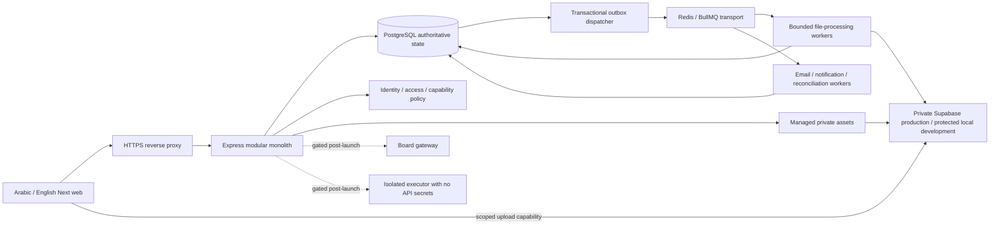

# Target architecture

Version **1.1, 22 October 2026**. This is the target architecture. Completed M0 controls at **d9c720f**, exact tests and limits are recorded in [current status](CURRENT_STATUS.md); managed assets, revision workflows and durable workers below remain later milestones. The [M1 handoff](NEXT_STEPS.md) starts with versioned migrations, then shared contracts/data primitives before integrating access and assets. Baseline code evidence remains in [the audit](../audit/PRODUCT_READINESS_REVIEW.md). [API contracts](API_DATA_CONTRACTS.md) distinguish implemented compatibility endpoints from normative future boundaries.

## Deployment and trust boundaries

Retain Next.js/React and the Express modular monolith, Prisma/PostgreSQL and the existing JWT/bcrypt/refresh-session identity system. Add separate file-processing and delivery worker deployments. Do not replace identity with Supabase Auth or create per-feature microservices. Workers are deployment boundaries for resource isolation and retry durability; domain ownership remains in the monolith's service interfaces.

The browser is untrusted. It cannot choose actor IDs, grades, prices, answer release, ownership, storage paths, upload completion state or feature authorization. Supabase service credentials, encryption/signing keys and database credentials stay server-side; no `NEXT_PUBLIC` secret. Private file delivery is a bearer capability or a policy-checking proxy, not a public bucket alias.

## Domain modules and data ownership

| Module | Owns | Exposes / restrictions |
|---|---|---|
| Identity | User, approval, authVersion, session/token families, MFA, recovery, consent entry hooks | Current actor and permission claims; security changes revoke consistently |
| Academic registry | Stage, grade, track, year, term, subject, curriculum edition, outcome | Stable IDs/codes and coherent references, admin-managed |
| Authoring/review | Course owner/editor grants, canonical modules/lessons/blocks, draft/published revisions, review decisions | Studio commands and immutable PublishedRevision; no direct published mutation |
| Provenance/issues | Sources, citations, permission declarations, content error/correction records | Publication requirements and editor follow-up; private permission evidence |
| Assets | Upload sessions, quota, originals/renditions, attachments, processing state, delivery grants | Asset IDs and purpose-specific capabilities; no arbitrary external storage URL input |
| Assessments/assignments | Banks/questions, versioned definitions, attempts, per-question grades, rubrics, submissions | Safe student DTOs; private snapshots only within grading service |
| Access/commerce | Products/offers, order snapshots, ledger/events, fulfillment, grants/subscriptions, vouchers | One effective AccessPolicy and audience projection; no duplicate domain checks |
| Progress/personal study | Stable lesson completion, bounded watch intervals, resume, own notes/bookmarks, staged mastery | Private student records, not fabricated understanding metrics |
| Communications | Announcements, notification inbox/preferences/delivery, supplied live meeting presentation | Durable recipient/attempt status; no false meeting provisioning |
| Support/privacy | Tickets, identity-verified export/deletion, retention/legal holds | Least-privilege operations and recoverable jobs |
| Audit/events/operations | Durable actual-actor audit, outbox/inbox/dispatch, readiness, capability controls | Transaction-aware writes and operational recovery |
| Analytics | Versioned projections from authoritative facts | No invented payments/mastery, scoped aggregates |

Modules call typed service interfaces. Controllers validate transport input, obtain actor and delegate. A module cannot import another module's raw Prisma writes to bypass its invariants. Prisma models are not response types. Transaction context may be passed to owned service methods so a course/product change or payment/grant event remains atomic.

## Implementation ownership

| Shared concern | Sole implementation owner | Consumers / what they own |
|---|---|---|
| Shared Zod/DTO/OpenAPI package | [ENH-02](tasks/ENH-02.md) | ENG-04 adopts route schemas; domain tasks add their schemas here |
| Migrations/upgrade/restore framework | [ENG-05](tasks/ENG-05.md) | Each domain writes its migrations and preservation assertions |
| Academic taxonomy | [ENH-01](tasks/ENH-01.md) | ENG-08 repairs read side effects/uniqueness; LRN-15 catalog filters |
| Canonical modules/lesson mapping | [LRN-07](tasks/LRN-07.md) | Player/progress/revisions consume it; no second Section hierarchy |
| Effective access/audience policy | [COM-01](tasks/COM-01.md) | COM-09 owns date/lifecycle primitives; SEC-12 domain guards; COM-10 roster projection |
| Catalog allowlist / learning separation | [SEC-04](archive/completed/M0/SEC-04.md) | SEC-06 visibility, LRN-09 previews, ENG-10 performance |
| Safe question/result serializers | [SEC-05](archive/completed/M0/SEC-05.md) | SEC-08 applies terminal result serializer; SEC-07 author/bank ACL |
| Asset library/upload/processing pipeline | [ENH-03](tasks/ENH-03.md) | SEC-02 closes existing bypass; SEC-03 validation; ENG-09 bounds existing streams; ENH-07 supplies tracks |
| Immutable publication/review | [LRN-05](tasks/LRN-05.md) | ENH-06 orchestrates UI; ENH-04 import creates drafts; ENH-05 rights/issues |
| Assessment engine/version migration | [LRN-02](tasks/LRN-02.md) | LRN-01 expiry fix, LRN-03 grade policy, LRN-04 atomic submit, LRN-10/11 UI timing |
| Structured import engine | [ENH-04](tasks/ENH-04.md) | ENH-06 authoring UI consumes preview/commit, no second parser |
| Payment state/ledger/fulfillment | [COM-06](tasks/COM-06.md) | COM-07 product snapshot, COM-08 voucher atomicity, COM-12 UI, COM-04 future adapters |
| Audit/outbox dispatch | [ENG-07](tasks/ENG-07.md) | ENH-10 notification delivery; COM-06 reconciliation; ENG-12 future webhooks |
| Server capability policy | [ENG-03](archive/completed/M0/ENG-03.md) | SEC-15/LRN-08 immediate containment; staged feature tasks own enablement evidence |
| Interface/content locales | [LRN-16](tasks/LRN-16.md) | ENH-07 caption/accessibility specifics; all frontend tasks consume catalogs |
| Whole CI/test safety/advisory upgrades | [ENG-13](tasks/ENG-13.md) | Domain tasks own meaningful regression assertions and fixtures |
| Privacy/support/retention execution | [ENH-16](tasks/ENH-16.md) | ENH-11 minor consent/guardian linkage; identity ENG-11 recovery |
| Metric definitions/projections | [ENH-17](tasks/ENH-17.md) | COM-10 replaces current fabricated revenue and faulty rosters |

No dependent task is completed just by linking an owner; it must adapt its own consuming endpoint/UI and attach tests for its original finding.

## Canonical data and invariants

`CourseModule` is the existing canonical module table, presented as a module/unit. A Lesson has one required module after migration and a course-consistent composite FK. Preserve lesson IDs, progress, ordering and preview settings. Section→module mapping is permanent migration provenance until legacy interfaces retire. Block IDs remain stable; revisions snapshot order/type/config/required policy and exact referenced assessment/media versions.

`Course.ownerId` is separate from `createdById`/acting editor. Explicit `ContentAssignment` grants specify edit/review/grade capabilities. Draft ETags protect autosave/reorder; submitted revisions are immutable hashes. `ReviewDecision.revisionId` and the published pointer must refer to exactly that snapshot. Teacher approvals cannot be disabled via a cosmetic setting.

`Assessment/QuestionPool/QuestionItem` become the canonical engine with version entities and private immutable attempt snapshots. `Quiz/Question/QuizAttempt` survive through ID mappings/adapters and preserved historical data; do not run two new grading engines. Unknown legacy snapshot provenance is explicit. Pending manual grades are not zero or final pass/fail.

Products identify valid course/subject/bundle scopes. Order items freeze EGP price, duration, resource and policy. Payment state differs from fulfillment state; a paid-but-pending grant is visible and recoverable. Source-order grant uniqueness and immutable ledger events prevent duplicate approvals/refunds/callback effects. Historic subscriptions remain evidence and participate in the shared effective-access resolver.

## Asset and worker design

Every educational/submission/receipt/rights/caption file is a managed asset with original checksum, actor, owner, purpose, state and attachment. A staged upload is not a published lesson. Only READY assets can attach to submitted publishable revisions; rejected/quarantined files stay inaccessible.

The API issues a per-object upload capability after authorization/quota reservation. Completion verifies stored bytes/type/checksum and queues work. Separate bounded workers scan and process supplied media, update states conditionally and emit completion events. Originals are immutable, derivatives versioned. No API-host 500 MB memory buffer or silent public URL fallback. Actual production Supabase behavior is governed by C03 and its referenced vendor contracts.

Postgres outbox is durable source of truth. Redis/BullMQ is delivery transport with at-least-once semantics. Dispatcher crashes/retries may enqueue twice; consumer unique keys/conditional transitions must dedupe. Use event IDs, aggregate version and schema version, bounded retries/dead letters, queue depth alerts and admin replay with audit. Email/webhook/network delivery is never claimed exactly once. No memory-only durable success.

Media workers may hold scoped storage credentials and limited job/database access; sandbox execution workers may not. Do not place user code in a media-processing container and call it isolated. Realtime boards have their own future ticket/operation/snapshot design and remain disabled until ENH-14.

## Identity, policy and consistency

Retain app-issued access JWTs and hashed server refresh registry. Add authVersion/current account-state checks, atomic family rotation and encrypted staged MFA/recovery. Migrate client access tokens out of persistent localStorage to memory while retaining httpOnly refresh cookies; protected proxy/cookie/CSRF/CORS behavior is tested at the intended deployment. No cross-account Zustand/React Query cache.

Access checks capture one server time, current actor and course lifecycle. Grant intervals are half-open, revocation explicit. Per-user cache keys include auth/access/course version; durable invalidation helps performance but the DB is authoritative for mutations. Failure to verify identity/access is unavailable/denied, never permission from a stale client boolean.

The API must enforce hard disabled capabilities before any side effect. AI is removed, not a staged flag. Code/board/provider/developer/guardian/offline/certificate flags are independently hard-off until reviewed. UI hides/disables controls only after the server policy is established.

## Deployment and operations shape

Deploy HTTPS edge, web, API, processing worker, delivery/dispatcher worker, PostgreSQL, Redis and private Supabase storage with environment-specific secrets/roles. Compose currently provisions data services only; app containers/deployment probes/secrets/backup jobs are planned in ENG-06/ENG-13 and M3 operations, not already provided. Pin and verify supported runtimes/dependencies during implementation.

Readiness fails when required durable paths cannot work; liveness proves process survival only. SIGTERM stops admissions/readiness then drains connections/jobs with bounded termination. Production cannot fall back to a process-local file or audit list. Monitor access denials, upload states, scan/transcode errors, queue lag, unfulfilled payments, email failures and backup restoration age.

Use [migration operations](MIGRATION_OPERATIONS.md) for expand/backfill/cutover and [release gates](TESTING_RELEASE_GATES.md) before student or paid traffic.
