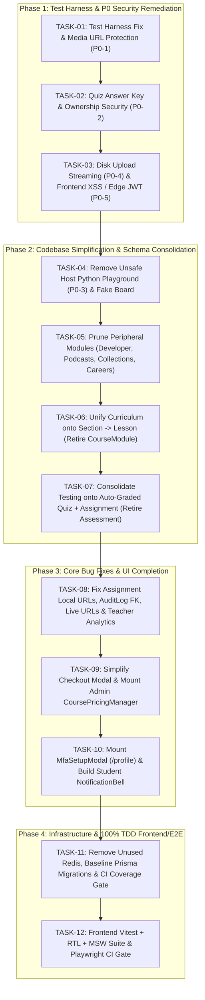

# 00 — Master Implementation Plan & Task Index

This directory (`docs/tasks/`) contains the complete, step-by-step **Test-Driven Development (TDD) Implementation Plan** for simplifying, securing, and completing **EduPlatform** into a production-ready software system.

Every task is designed as an **atomic, independently verifiable unit of work** with:
1. **Objective & Architectural Rationale**
2. **Exact Files to Modify / Create / Delete**
3. **Step 1 — Red Phase (Write Failing Tests First)**
4. **Step 2 — Green Phase (Exact Code Implementation)**
5. **Step 3 — Refactor & Cleanup Phase**
6. **Code Review Checklist & Acceptance Criteria**
7. **Verification Commands (Automated Tests, Typecheck, Build)**

---

## Task Dependency Graph

---

## Complete Task Catalog

| Task ID | Task Document | Phase | Status | Summary of Work |
| :--- | :--- | :---: | :---: | :--- |
| **TASK-01** | [TASK-01-test-harness-and-media-security.md](./TASK-01-test-harness-and-media-security.md) | Phase 1 | ✅ Completed | Fix `tests/setup.ts` secret override; strip `videoUrl`/`fileUrl` from un-entitled course responses; remove unauthenticated `/uploads` static exposure for lesson media; add entitlement-gated material download route. |
| **TASK-02** | [TASK-02-quiz-security-and-answer-key-protection.md](./TASK-02-quiz-security-and-answer-key-protection.md) | Phase 1 | ✅ Completed | Strip `Question.correctAnswer` in `CourseService.sanitizeCourseContent`; enforce teacher course ownership (`getQuizOwnerTeacherId`) and student `hasLessonAccess` in `QuizController.getQuiz`. |
| **TASK-03** | [TASK-03-upload-streaming-and-frontend-xss-edge-auth.md](./TASK-03-upload-streaming-and-frontend-xss-edge-auth.md) | Phase 1 | ✅ Completed | Replace `multer.memoryStorage()` (500MB RAM buffer) with `multer.diskStorage()`; sanitize `TiptapEditor.tsx` HTML via `isomorphic-dompurify`; validate `exp` and role enum in `client/src/middleware.ts`. |
| **TASK-04** | [TASK-04-remove-unsafe-playground-and-fake-board.md](./TASK-04-remove-unsafe-playground-and-fake-board.md) | Phase 2 | ✅ Completed | Remove `Playground` (host Python RCE `P0-3`) and `Board` (fake multiplayer canvas) models, routes, AppConfig flags, and editor components. |
| **TASK-05** | [TASK-05-prune-peripheral-modules-developer-podcasts-collections-careers.md](./TASK-05-prune-peripheral-modules-developer-podcasts-collections-careers.md) | Phase 2 | ✅ Completed | Remove 4 non-core modules (`developer`, `podcasts`, `collections`, `careers`), 8 Prisma models, and broken/unmounted UI components (`CollectionsManager`, `PodcastPlayer`, `CollectionCard`, `CareerPickerModal`). |
| **TASK-06** | [TASK-06-unify-curriculum-onto-section-drop-course-module.md](./TASK-06-unify-curriculum-onto-section-drop-course-module.md) | Phase 2 | ✅ Completed | Retire `CourseModule` and `Lesson.moduleId`; standardize 100% of curriculum authoring, reordering, and playback on `Course` → `Section` → `Lesson`. |
| **TASK-07** | [TASK-07-consolidate-testing-quiz-and-assignment-retire-assessment.md](./TASK-07-consolidate-testing-quiz-and-assignment-retire-assessment.md) | Phase 2 | ✅ Completed | Retire the redundant 4-model `assessment` module; remove `ESSAY` from `QuizQuestionType` so all quizzes auto-grade deterministically; route written submissions to `Assignment`. |
| **TASK-08** | [TASK-08-fix-assignments-audit-logs-live-sessions-and-teacher-analytics.md](./TASK-08-fix-assignments-audit-logs-live-sessions-and-teacher-analytics.md) | Phase 3 | ✅ Completed | Allow relative `/uploads/...` URLs in `submitAssignmentSchema`; pass real `adminUserId` in `reviewCourseStatus` audit log; accept real teacher meeting URLs in `LiveService`; fix `TeacherService` course entitlements & revenue calculation. |
| **TASK-09** | [TASK-09-simplify-checkout-and-mount-admin-pricing.md](./TASK-09-simplify-checkout-and-mount-admin-pricing.md) | Phase 3 | ✅ Completed | Streamline `CheckoutModal.tsx` onto Manual Wallet + Voucher Redemption (hiding unconfigured gateway tabs unless enabled); mount `CoursePricingManager.tsx` in `AdminDashboard.tsx`. |
| **TASK-10** | [TASK-10-mount-mfa-setup-and-student-notification-bell.md](./TASK-10-mount-mfa-setup-and-student-notification-bell.md) | Phase 3 | ✅ Completed | Mount `MfaSetupModal.tsx` in `/profile/page.tsx` with MFA status badge and re-enrollment flow; build and mount `NotificationBell.tsx` in `Navbar.tsx` wired to `/api/v1/notifications/me`. |
| **TASK-11** | [TASK-11-infra-cleanup-redis-removal-and-prisma-migrations.md](./TASK-11-infra-cleanup-redis-removal-and-prisma-migrations.md) | Phase 4 | ⏳ Pending | Remove unused `redis` service from `docker-compose.yml`; generate baseline Prisma migration in `server/prisma/migrations/`; enforce `vitest run --coverage` in CI. |
| **TASK-12** | [TASK-12-frontend-vitest-rtl-and-playwright-ci.md](./TASK-12-frontend-vitest-rtl-and-playwright-ci.md) | Phase 4 | ⏳ Pending | Configure Vitest + React Testing Library + MSW in `client/`; write unit/component test suites; un-skip `client/e2e/video.spec.ts`; add Playwright E2E job to `.github/workflows/ci.yml`. |

---

## Mandatory Engineering Workflow for Every Task

For each task `TASK-XX`:
1. **Read the task specification file** in `docs/tasks/TASK-XX-*.md`.
2. **Execute Step 1 (Red)**: Write or update the automated test suite first and run it to confirm the new test fails for the expected reason.
3. **Execute Step 2 (Green)**: Apply the exact schema, backend, and frontend changes until the new test passes.
4. **Execute Step 3 (Refactor & Full Regression)**: Run `npm run typecheck` and `npm test` in `server/`, and `npm run typecheck`, `npm run lint`, and `npm run build` in `client/`.
5. **Perform Code Review**: Verify every item in the task's **Review Checklist** before moving to `TASK-(XX+1)`.
